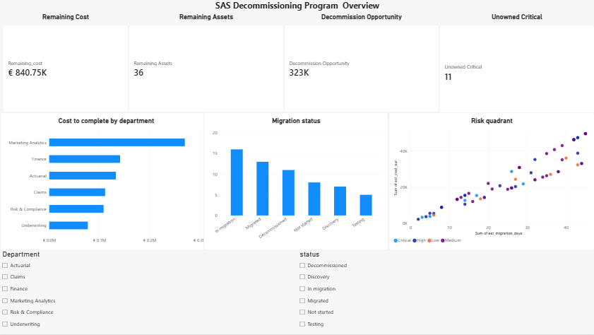
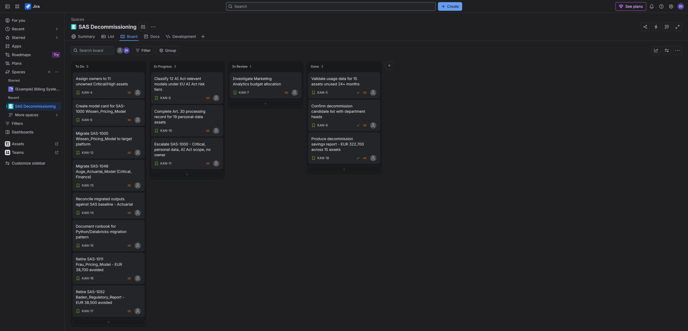

# SAS Decommissioning Migration Tracker

A programme tracking toolkit for retiring a legacy SAS analytics estate: SQL analysis, a Power BI dashboard, and a Jira delivery board, built on a synthetic 60-asset inventory.

All data is synthetic, generated with Faker. No real organisational data is used.

## Background

Insurers have run reporting and actuarial work on SAS for decades and many are now moving off it. The difficult part isn't rewriting the code. It's that nobody knows what's in the estate after thirty years: which assets are still used, which hold personal data, who owns them. That has to be answered before anything moves.

## Key findings

**EUR 322,700 is budgeted to migrate 15 assets that nobody has run in over two years.** That's 38% of the remaining migration budget going to systems that should probably be switched off instead.

Marketing Analytics holds 32% of the remaining budget (EUR 270,200) despite being the lowest-criticality department. 39% of that spend is on assets already flagged as dormant.

11 Critical or High criticality assets have no assigned owner, so nobody can validate a migrated version of them.

Overall: 60 assets, 24 complete, 36 remaining at EUR 840,750 and 895 person-days.

## Dashboard



## Delivery board



## The queries

Six queries in `sql/queries.sql`:

| | Question |
|---|---|
| Q1 | What does it cost to finish, by department? |
| Q2 | Which unfinished assets haven't been run in 24+ months? |
| Q3 | Which unmigrated assets contain personal data? |
| Q4 | Which Critical or High assets have no owner? |
| Q5 | How far along is the migration? |
| Q6 | Which assets fall within EU AI Act scope? |

Q3 and Q6 flag assets needing compliance review before migration. Classifying them would need legal input and is out of scope.

## Running it

```bash
python -m venv venv
venv\Scripts\activate
pip install pandas faker

python generate_inventory.py
python load_db.py
python run_queries.py
```

Power BI reads `data/sas_asset_inventory.csv` directly.

## Limitations

The data is random, so no real correlations exist in it. This shows method, not insight into real systems.

The SQL is duplicated between `run_queries.py` and `sql/queries.sql`. A longer-lived project would read the `.sql` file as the single source of truth.

Power BI reads the CSV rather than the database because it has no native SQLite connector. In production it would query the database.

The cost/effort scatter shows three parallel bands because cost is days multiplied by day rate, and the generator only uses three rates. Real data would be messier.

Compliance classification is out of scope. Assets are flagged for review, not assessed.